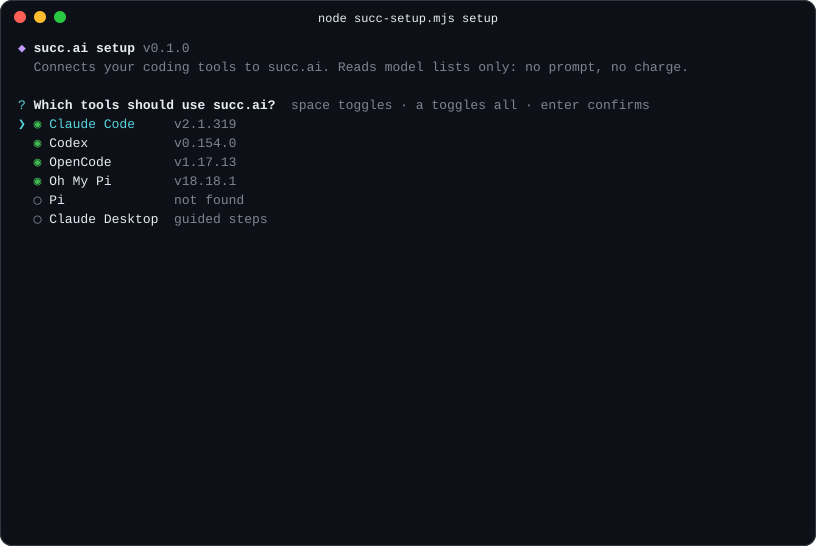
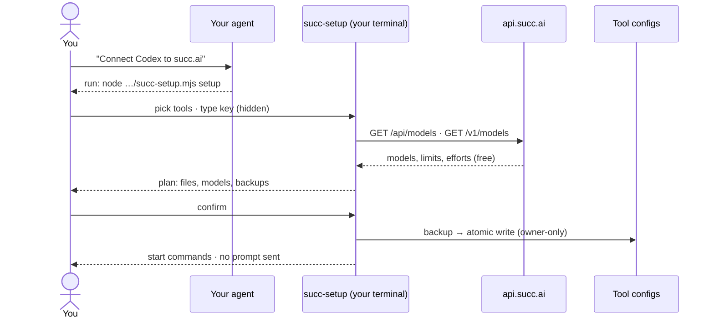

<div align="center">

# succ.ai skill

**Connect your coding agents to [succ.ai](https://succ.ai) without pasting your API key into a chat.**

Claude Code · Codex · OpenCode · Oh My Pi · Pi · Claude Desktop



</div>

> **Private preview.** Not published yet. The install command below works once the repository is public.

## Why

Setting up a third-party API in a coding agent usually means pasting a key into a chat, hand-editing JSON, YAML and TOML, and guessing context sizes. This skill does it differently:

- 🔑 **Your key stays out of the chat.** You type it into a hidden prompt. It goes only into the tool's own config, readable only by you.
- 🆓 **Setup costs nothing.** The script only reads model lists (`GET`). It never sends a prompt.
- 🧭 **Live models.** Context windows, output limits and reasoning efforts come from the live catalog, so there are no sample values like 32K/4K.
- 🛟 **Safe edits.** You see the plan before anything is written. Every file is backed up first, writes are atomic, and the script refuses anything it can't merge safely.
- 🧯 **An error playbook.** It tells your agent what 402, 409, 429 and 503 mean, and how to avoid paying twice after a timeout.

## Install

```sh
npx skills add vinaes/succ-ai-skill
```

Then ask your agent something like *"connect Claude Code and Codex to succ.ai"*. The agent reads the skill and gives you one command to run.

**Without an agent:**

```sh
git clone https://github.com/vinaes/succ-ai-skill
node succ-ai-skill/skills/succ-ai/scripts/succ-setup.mjs setup
```

This needs Node.js 18 or later and has no dependencies. You'll also need a succ.ai API key from [succ.ai/dashboard/keys](https://succ.ai/dashboard/keys).

## How it works



## What it changes

| Tool | Writes | Key stored in | Start with |
| --- | --- | --- | --- |
| Claude Code | `~/.claude/succ.settings.json`, a launch profile that leaves your normal Claude Code alone (or optionally your `settings.json`) | that file | `claude --settings ~/.claude/succ.settings.json` |
| Codex | `[model_providers.succ]` in `~/.codex/config.toml`, plus `~/.codex/succ-models.json` | `config.toml` | `codex -c model_provider=succ -c model_catalog_json=… --model <id>` |
| OpenCode | `provider.succ` in `opencode.json` | OpenCode's `auth.json` | `opencode --model succ/<id>` |
| Oh My Pi | `providers.succ` in `~/.omp/agent/models.yml` | that file | `omp --model succ/<id>` |
| Pi | `providers.succ` in `~/.pi/agent/models.json` | that file | `pi --provider succ --model <id>` |
| Claude Desktop | nothing; it prints the four in-app steps | the app | n/a |

Your default models, other providers, logins, permissions, budgets and the account's ZDR setting stay as they are.

## Guarantees

The tests in [`tests/`](tests) check each of these:

- **Network:** one `fetch` call site, `GET` only, redirects refused, and only to `api.succ.ai`. The tests point it at a loopback mock instead, which is the only override it accepts.
- **The key** is put into the `Authorization` header only. It is never printed, never passed in a command argument, never given to another program, and never shown in the plan or the summary.
- **Files:** nothing is written before you confirm. Backups come first, then an atomic replace. Linked or foreign-owned paths are refused. Files holding the key are `0600` on macOS and Linux, and have a single-owner ACL on Windows.
- **No telemetry** and no third-party hosts.

## For agents

```
skills/succ-ai/
├── SKILL.md              ground rules, task router, quick reference
├── references/
│   ├── setup.md          connect a tool (script first, manual fallback)
│   ├── models.md         choose a model from live metadata, no paid probes
│   └── errors.md         error table, uncertain requests, streams and tools
└── scripts/
    └── succ-setup.mjs    setup (interactive) · models --json (for agents)
```

## Development

```sh
node --test tests/*.test.mjs   # unit tests, full interactive flow, guarantees
node tools/record-demo.mjs     # re-record assets/demo.svg against a local mock API
```

The generated configs were checked against OpenCode 1.17.13, Oh My Pi 18.18.1 and Codex 0.154.0: each lists the succ models. That check loaded the configs but sent no prompt, so inference, streaming and tool calls are not covered.

## License

No license has been chosen yet.
